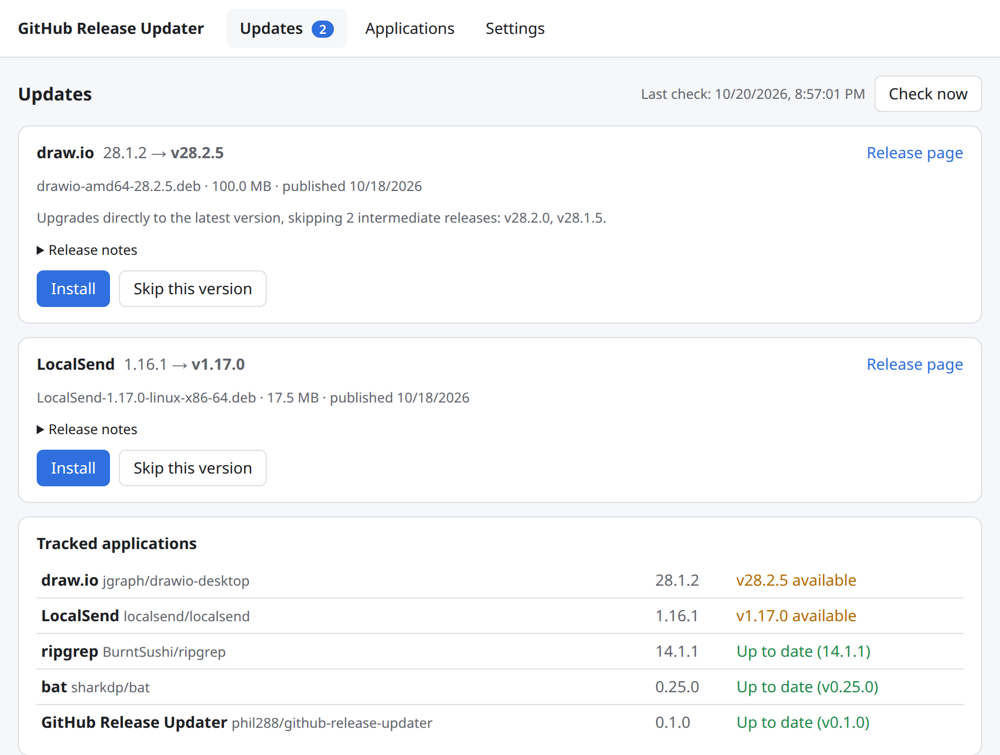
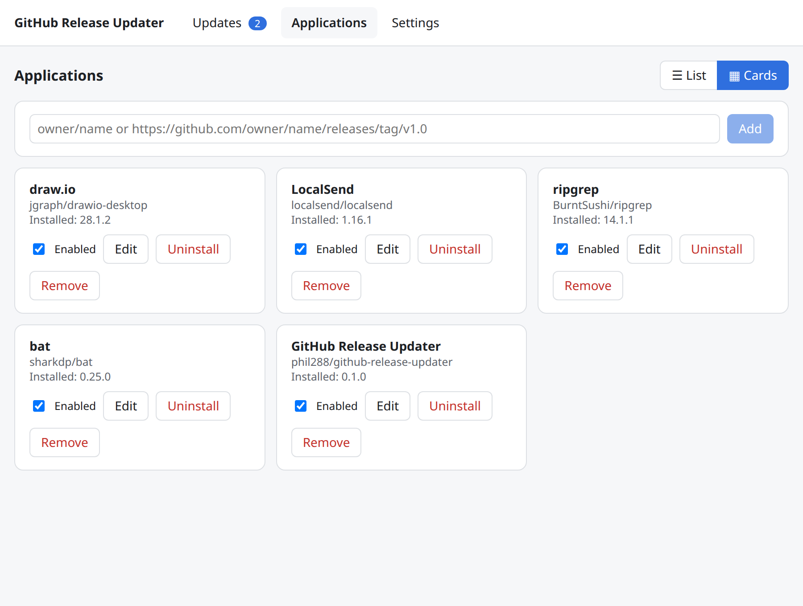
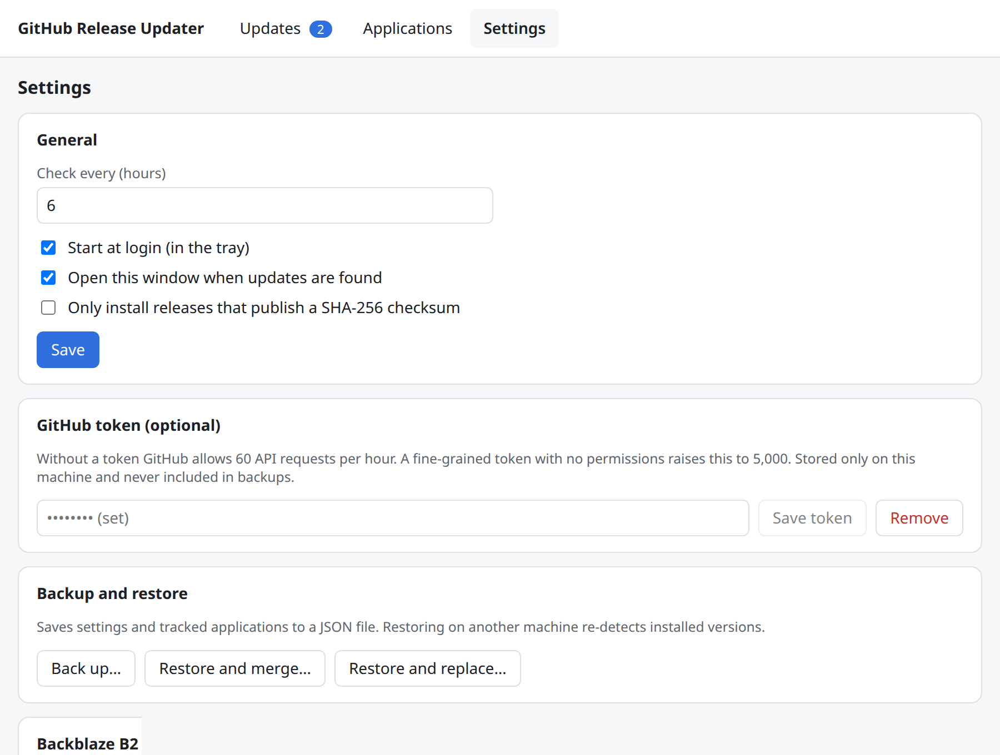

<div align="center">


# GitHub Release Updater

**Auto-update the apps you installed from GitHub releases, on Ubuntu and Windows.**

A small tray app that watches GitHub repositories, then downloads, verifies and installs
new `.deb` (Ubuntu/Debian) or `.msi` (Windows) release packages when you click Install.
Think *Obtainium*, for the desktop.

[](https://github.com/phil288/github-release-updater/actions/workflows/ci.yml)
[](https://github.com/phil288/github-release-updater/releases/latest)
[](https://github.com/phil288/github-release-updater/releases)
[](LICENSE)


[**Download**](https://github.com/phil288/github-release-updater/releases/latest) ·
[Website](https://phil288.github.io/github-release-updater/) ·
[Report a bug](https://github.com/phil288/github-release-updater/issues/new/choose)



</div>

## Why

Plenty of good desktop apps ship only as a `.deb` or `.msi` on their GitHub releases page:
no apt repository, no Microsoft Store, no built-in updater. You install them once and quietly
fall behind. GitHub Release Updater keeps track of them for you and installs new versions
with the OS's own package tools, after you approve.

## Features

- **Watch any public repository.** Paste `owner/name` or a release URL. Checks every 6 hours
  (configurable) and on demand.
- **Picks the right file.** Matches your OS and CPU (`x86_64`/`amd64`/`x64`, `aarch64`/`arm64`,
  `x86`/`i386`) and skips `-cli`, `-portable` and other-architecture assets. A per-app regex
  overrides the choice.
- **Straight to the latest version.** Skips the releases in between, and re-checks right before
  installing so a release published in the meantime is not missed.
- **Verified downloads.** SHA-256 from GitHub's asset `digest`, `<asset>.sha256` or `SHA256SUMS*`.
  HTTPS only, GitHub hosts only.
- **You stay in control.** A desktop notification announces updates; nothing installs until you
  click Install and approve the OS prompt.
  - Ubuntu: `pkexec apt-get install ./file.deb`, polkit password dialog, live apt output.
  - Windows: `msiexec /i file.msi /passive` started elevated, UAC prompt, MSI progress window.
- **Uninstall** tracked apps from the same window (`apt-get remove` / `msiexec /x`).
- **Backup and restore** settings as JSON, or automatically to **Backblaze B2**. The GitHub token
  and B2 key are stored separately and never written to backups.
- **Quiet.** Starts at login, minimized to the tray. Built with Rust and Tauri. No telemetry, no account.

<table>
  <tr>
    <td></td>
    <td></td>
  </tr>
</table>

## Install

| OS | Get it |
|---|---|
| **Ubuntu 22.04+ / Debian** (x64) | Download `gh-release-updater_<version>_amd64.deb` from the [latest release](https://github.com/phil288/github-release-updater/releases/latest), then `sudo apt install ./gh-release-updater_*_amd64.deb` |
| **Windows 10 / 11** (x64) | Download `gh-release-updater_<version>_x64.msi` from the [latest release](https://github.com/phil288/github-release-updater/releases/latest) and run it. The installer is not code-signed yet, so SmartScreen asks once: *More info → Run anyway*. |

Each release includes `SHA256SUMS.txt` to verify your download. To build from source instead,
see [docs/development.md](docs/development.md).

## Usage

1. Open the app from the tray and go to **Applications**.
2. Add a repository, e.g. `localsend/localsend` or `https://github.com/jgraph/drawio-desktop`.
   The app detects the installed version when it can.
3. When a new release appears, you get a notification and the **Updates** page opens.
   Click **Install**, or **Skip this version**.

Add `phil288/github-release-updater` itself to keep the updater up to date.

**GitHub token (optional).** Without a token GitHub allows 60 API requests per hour, enough for
dozens of apps. A [fine-grained token](https://github.com/settings/personal-access-tokens/new)
with no permissions raises this to 5,000. It is stored only on your machine.

## FAQ

<details>
<summary>The app picks the wrong asset, or none.</summary>

Set a regex for Linux and/or Windows in the app's settings on the Applications page, and please
[report it](https://github.com/phil288/github-release-updater/issues/new?template=asset_not_detected.yml)
so the default rules get better.
</details>

<details>
<summary>Fedora, Arch, macOS, AppImage, Flatpak?</summary>

Not yet. `.deb` and `.msi` are supported today. Open or upvote an issue for the format you need.
</details>

<details>
<summary>Is it safe to auto-install from GitHub?</summary>

The app installs what the repository owner publishes, so track only projects you trust.
Downloads are HTTPS-only from GitHub hosts and checksum-verified when the release publishes a
checksum; turn on *Only install releases that publish a SHA-256 checksum* to require one.
See [SECURITY.md](SECURITY.md).
</details>

<details>
<summary>Where are settings stored, and how do I uninstall?</summary>

Settings live in `~/.config/dev.phil.gh-release-updater/` (Ubuntu) or
`%APPDATA%\dev.phil.gh-release-updater\` (Windows); see
[data locations](docs/development.md#data-locations). Uninstall with
`sudo apt remove gh-release-updater` or from *Settings → Apps* on Windows.
</details>

## Contributing

Bug reports, asset-detection reports and pull requests are welcome. Read
[CONTRIBUTING.md](CONTRIBUTING.md) to get started, and [SECURITY.md](SECURITY.md) to report a
vulnerability privately.

```bash
npm install
npm run tauri dev
cargo test --workspace && npm run check
```

| Path | Contents |
|---|---|
| `crates/updater-core` | GUI-free logic: repo parsing, versions, asset selection, GitHub client, download + checksum, installers, backup. Unit-tested. |
| `src-tauri` | Tauri 2 shell: tray, scheduler, notifications, commands. |
| `src` | Svelte 5 UI (Updates, Applications, Settings). |
| `site` | Landing page published to GitHub Pages. |
| `docs/tasks` | Decision records. |

## License

[MIT](LICENSE). GitHub Release Updater is not affiliated with or endorsed by GitHub, Inc.
